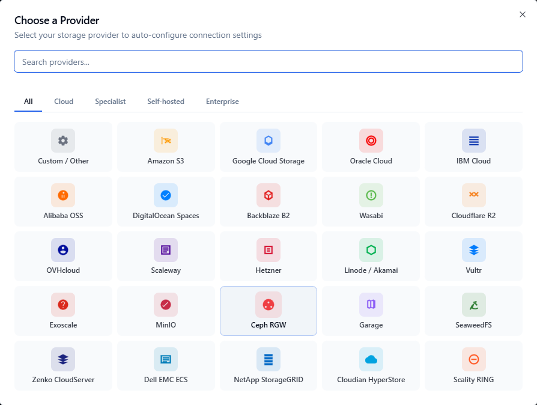

<div align="center">

# s3explorer.accessdevops.com

**Source of the website of [S3 Explorer](https://s3explorer.accessdevops.com/), the desktop S3 browser for Windows, macOS and Linux.**

[Website](https://s3explorer.accessdevops.com/) · [Download](https://github.com/AccessDevops/S3Explorer/releases/latest) · [Guides](https://s3explorer.accessdevops.com/guides/) · [Provider connection guides](https://s3explorer.accessdevops.com/providers/) · [Release notes](https://s3explorer.accessdevops.com/news/)



</div>

## About S3 Explorer

S3 Explorer connects to Amazon S3 and any S3-compatible storage (Cloudflare R2, Backblaze B2, Wasabi, MinIO, Ceph, Google Cloud Storage, Garage, SeaweedFS and more) from one desktop app, with 25 provider presets and a local index for searching buckets with millions of objects.

- Binaries and issue tracker: [AccessDevops/S3Explorer](https://github.com/AccessDevops/S3Explorer)
- Free with every feature and up to 5 connection profiles; [a licence](https://s3explorer.accessdevops.com/buy/) removes the limit.

## What this repository contains

The website, built with [Nuxt 4](https://nuxt.com/) and Tailwind CSS, deployed on Netlify. Every page is prerendered.

| Path | Content |
|---|---|
| `app/pages/` | Home, pricing, news, provider guides, guides |
| `app/lib/provider-content.ts` | Hand-written connection guide for each documented provider |
| `content/guides/*.md` | The [guides](https://s3explorer.accessdevops.com/guides/), one Markdown file each |
| `server/routes/` | RSS feed of the guides, `llms.txt`, `llms-full.txt` |
| `server/api/` | Release feed and the licence webhook |
| `netlify/plugins/indexnow/` | Notifies Bing of every sitemap URL after a production deploy |

## Improving a guide

Corrections are welcome, especially on provider settings, prices and comparisons, which change over time.

- **Report an error**: [open an issue](https://github.com/AccessDevops/S3Explorer/issues) with the page and what is wrong, ideally with a link to the provider's documentation.
- **Propose a change**: edit the guide's file in `content/guides/` and open a pull request.

A guide is a Markdown file with a short header. The file name becomes the URL, and the guide is added to the guides index, the sitemap, the RSS feed and `llms.txt` automatically:

```markdown
---
title: Under 50 characters, it is followed by "— S3 Explorer"
description: About 150 characters, used as the search snippet.
published: 2026-10-15
updated: 2026-10-15
providers: [aws, minio]
---

**In short:** two or three sentences that answer the question.

## Sections…

## Sources

- Links to the official documentation behind each fact
```

`providers` lists the provider ids whose connection guide links back to the guide. Facts need a source; outbound links are marked nofollow automatically. Images go in `public/images/guides/<slug>/` with their size as title, so the page does not shift while they load: ``.

## Running locally

Node 20 or later.

```bash
npm install
npm run dev
```

The site runs at `http://localhost:3000`. `npm run build` produces the production build. Copy `.env.example` to `.env` to enable analytics and the licence webhook; the pages work without it.
